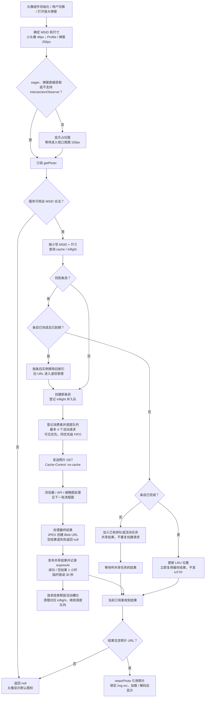
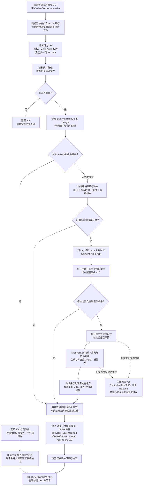
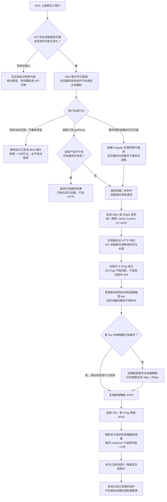
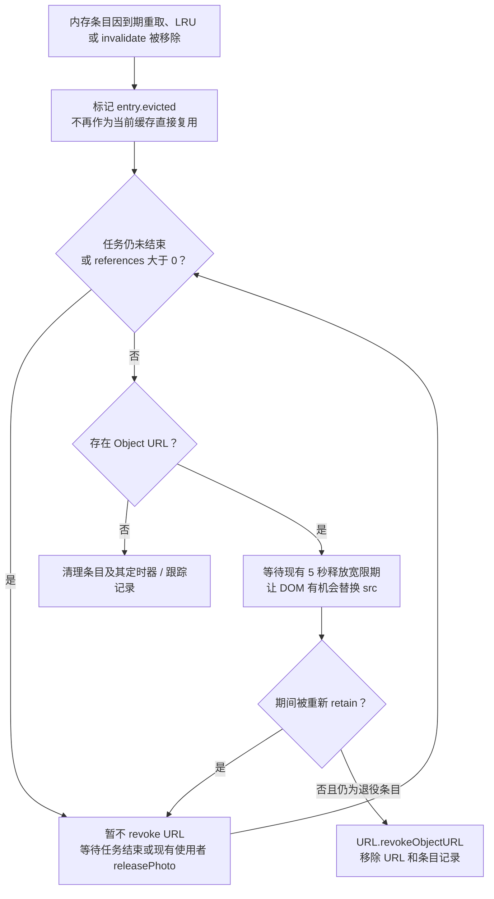

# 当前照片显示与换照流程图

核对日期：2026-11-10。依据当前本地源码生成，不代表所有部署环境已经同步配置。图中的 NAS 指 API 实际配置的照片目录；仓库的 `PhotoFolder` 示例仍是本地路径。

**当前实现：所有实际发出的照片 HTTP 请求都带 `Cache-Control: no-cache`。前端内存命中时不发 HTTP。此前讨论过的“仅 TTL 到期才添加请求头”方案没有应用到当前代码。**

文档使用 Mermaid，需在支持 Mermaid 的 Markdown 查看器中显示流程图。

## 1. 当前参数

| 项目 | 当前值或行为 |
| --- | --- |
| navigation bar / org-tree 小头像 | 48px |
| Profile 大头像 / 放大弹窗 | 256px，同用户同尺寸共享结果 |
| 前端内存缓存 key | 小写 MSID + 尺寸，例如 `alice01:48`、`alice01:256` |
| 前端内存有效期 | 成功图片及 204/404/403 空结果：返回时起 1 小时，命中不续期 |
| 临时错误负缓存 | 30 秒，到期允许重新获取 |
| 内存缓存容量 | 400 条 LRU；正在使用的旧 URL 另受引用管理保护 |
| 前端 HTTP 请求并发 | 每个服务实例最多 4 个，可见项优先，同优先级 FIFO |
| 懒加载预取范围 | 视口四周 100 CSS px；eager 头像直接加载 |
| HTTP 请求策略 | 实际发送时统一带 `Cache-Control: no-cache` |
| 成功及 304 响应缓存头 | `private, max-age=3600`，附带 ETag、Last-Modified |
| 后端缩略图缓存 | 独立内存缓存，200 MiB，30 分钟滑动过期 |
| 后端生成并发 | 配置为 4；与前端四请求上限是不同的限制 |
| 自动检查 / 换照通知 | 没有定时轮询，没有 NAS 向页面推送通知 |

下图聚焦 UI 使用的 48/256px 缩略图。无 `size` 的原图接口及其 `If-Modified-Since` 分支不展开。

## 2. 正常照片显示：前端流程

说明：

- 一小时有效期只在下一次订阅 `getPhoto()` 时检查，不会在时钟到点时主动请求或更换图片。
- 排队、活动中的任务不按一小时 TTL 淘汰；TTL 从结果返回时开始计算。
- 消费者退出时，仅在排队任务已没有消费者的情况下取消该待发任务。活动 HTTP 不因视图退出而取消，会继续完成并供缓存复用；服务销毁时才统一中止。
- 头像组件拿到结果后停止 IntersectionObserver。已显示头像不会因为后续滚动重新进入视口而自动检查版本。
- 头像加载或解码失败会回到默认图标。弹窗只有取得有效 URL 才打开，无图时不打开照片弹窗。

## 3. 正常照片显示：HTTP 验证与后端细化

说明：

- `no-cache` 要求验证后再复用，不等于 `no-store`。浏览器仍可存储图片，并在内容未变时通过 304 复用；没有可用缓存或条件头时可以返回 200。
- Angular 服务不手动读取 ETag、不手动添加 `If-None-Match`，也没有直接解析原始 304 的业务分支。不能把应用收到的响应状态简单等同于网络上的状态。
- 304 仍需经过鉴权和 NAS 元数据检查。图中的“未重新生成”不代表没有后端或 NAS 成本。
- 缓存容量不足时，生成结果可能无法长期保留，但本次仍可返回 JPEG。缓存成功入驻不是响应成功的必要条件。
- I/O、编解码器缺失等非图像数据错误不统一吞成坏图，由 API 宿主异常处理链路处理；输入非法和鉴权失败也有各自响应。前端对 403/404 视为空结果，其余请求错误保留 30 秒后允许重试。
- 浏览器已有有效 ETag 时，即使后端缩略图缓存已被淘汰，仍可能直接返回 304，不必重新生成缩略图。

## 4. NAS 换照后的显示流程

### 换照路径的关键边界

1. **正确更新时间戳是前提。** 后端缩略图 key 不包含文件内容 hash，使用路径、修改时间、尺寸、编码版本。仅覆盖字节但保留旧修改时间，不能保证更新。
2. **ETag 与缩略图 key 的输入并不完全相同。** ETag 额外包含文件长度；若仅长度变化、修改时间不变，可能发生 HTTP ETag 已变化但后端仍命中旧缩略图的情况。因此不能用“文件长度变了”代替更新时间戳。
3. **48px 与 256px 独立缓存。** Profile 取得新 256px 图片，不会直接更新导航栏和组织树已缓存、已显示的 48px 图片。它们也不会因同一 MSID 而共享同一个到期时间。
4. **当前实现整页刷新无需等待内存 TTL。** 新服务的首次请求同样带 `no-cache`。在实际 NAS 版本能被正确识别、链路正常且部署了此实现时，刷新会检查当前照片。
5. **路由切换不等于整页刷新。** 常驻导航栏不一定重建；只有实际触发 `getPhoto()` 订阅的组件才重新检查缓存。
6. **不承诺整页刷新时所有尺寸在完全同一时刻完成。** 头像懒加载、四请求队列及网络耗时会影响每个组件拿到结果的时刻。
7. **换照页面没有上传实现。** 当前 `onEditPhotoClick()` 只显示未来开放的提示；上图的换照操作发生在外部 NAS 导入 / 替换流程，不是前端上传成功回调。

## 5. 缓存失效与旧图片资源释放

- `retainPhoto` / `releasePhoto` 保护仍在显示的 URL；Observable 完成不代表视图已不再使用图片。
- 头像组件切换 MSID、清理图片、销毁时释放引用；弹窗关闭、切换用户或路由时释放引用并隔离迟到结果。
- 当前头像组件执行 `load()` 时会先把自身照片置空，再获取结果；上述保护主要确保其他仍持有旧 URL 的视图不被提前破坏，并非所有重新加载都保留原图直到新图返回。
- `invalidate(msid)` 能清理该用户所有尺寸的缓存索引并隔离在途条目，但它本身不通知已显示的组件重新加载，不构成自动刷新功能。
- 整页刷新会销毁旧的 JavaScript 运行环境；服务销毁时也有中止请求、清理队列和 URL 的兜底逻辑。资源清理不只依赖 `beforeunload` 必须触发。

## 6. 常见操作的实际结果

| 操作 | 当前结果 |
| --- | --- |
| 同一页面一小时内再次请求同一 MSID、同一尺寸 | 内存命中，不访问 API |
| 页面打开超过一小时但不操作 | 不自动请求，已显示图片可继续保持 |
| 到期后重新创建头像组件或重新打开弹窗 | 下一次订阅发现到期，进行 HTTP 验证 |
| NAS 换照后立即整页刷新 | 清空旧页面内存，新请求要求验证；正确识别源版本后显示新图 |
| 只重新进入 Profile | 取决于该组件是否重建及 256px 缓存是否有效；不保证导航栏更新 |
| 仅调用 invalidate | 下次获取时不再用旧缓存，但已显示组件不会因此自动加载 |
| 缺图后在 NAS 新增照片 | 当前空结果也有一小时有效期；内存失效后获取，或整页刷新重新验证 |
| 临时错误后等待 30 秒 | 允许下次请求重试，不会自行发起重试 |

## 7. 对应源码

- [照片服务：内存缓存、TTL、队列、HTTP 请求、Blob 引用](C:/Users/lxzxc/workspace/ui/src/app/service/user-photo.service.ts)
- [头像组件：48/256 映射、懒加载、订阅及显示](C:/Users/lxzxc/workspace/ui/src/app/components/common/user-avatar/user-avatar.component.ts)
- [用户视图：照片弹窗及当前换照入口](C:/Users/lxzxc/workspace/ui/src/app/components/user-view/user-view.component.ts)
- [拦截器：照片请求头原样保留](C:/Users/lxzxc/workspace/ui/src/app/interceptor/custom-request-interceptor.service.ts)
- [照片 API：源元数据、ETag、304 与响应](C:/Users/lxzxc/workspace/ui/backendApi/photoController.cs)
- [后端缩略图服务：缓存、同 key 合并及生成限流](C:/Users/lxzxc/workspace/ui/backendApi/photoThumbnailCache.cs)
- [后端参数默认值](C:/Users/lxzxc/workspace/ui/backendApi/PhotoOptions.cs)
- [后端当前配置示例](C:/Users/lxzxc/workspace/ui/backendApi/appsettings.json)

以上流程按当前源码静态核对。未在本轮修改业务代码、操作 NAS 或执行生产部署。
